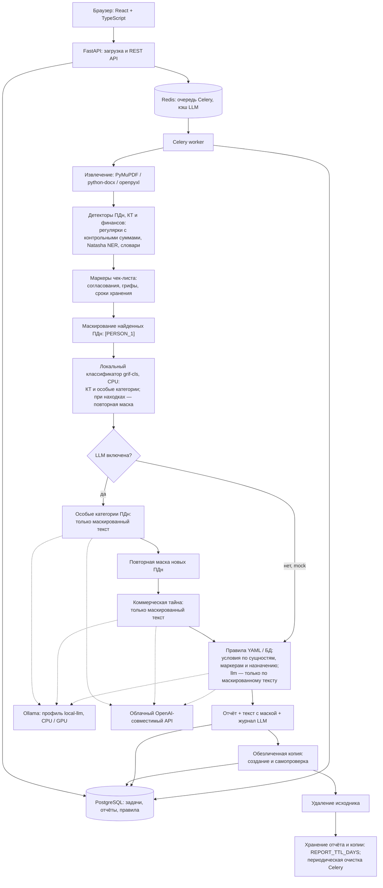
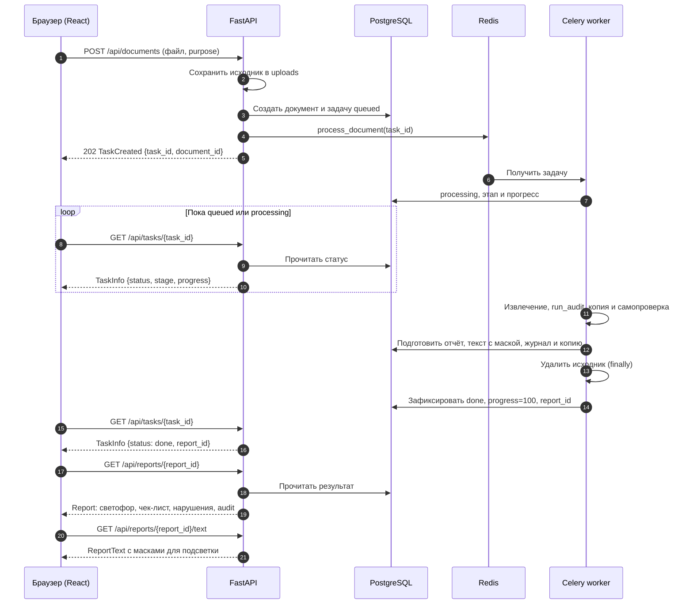

# Архитектура «Грифа»

«Гриф» проверяет документы закупок в очереди Celery. FastAPI принимает файл или
текстовый запрос и возвращает идентификатор задачи; браузер получает результат
отдельно. Схемы данных и API определены в [contracts.md](contracts.md).

## Компоненты и конвейер

Сплошные стрелки показывают обработку и сохранение, пунктирные — необязательные
вызовы выбранного провайдера LLM. Ollama и облачный API — альтернативы. В mock
этих вызовов нет. В `run_audit` маркеры вычисляются сразу после детекторов, до
маскирования; правила используют уже найденные маркеры после смысловых проверок.
Классификатор работает локально без API-ключа; если модели нет, шаг пропускается
с предупреждением. Найденные им особые категории маскируются до первого вызова LLM.

После `run_audit` worker создаёт копию и повторным извлечением проверяет, не остались
ли в ней найденные исходные значения ПДн. Если копия не прошла самопроверку или
создать её не удалось, отчёт сохраняется без неё (`redacted_available=false`).
Удаление исходника выполняется в `finally`, в том числе при ошибке проверки.

## Путь документа

Для ввода текста используется `POST /api/queries` с `QueryRequest`; дальше путь тот
же. При ошибке задача получает `failed` и понятное сообщение `error`; исходник
также удаляется. Цитаты и подсветка сохраняют координаты исходного текста.

## Модули сервисов

Пути указаны относительно корня репозитория.

| Модуль | Папка или файл | Что делает |
|---|---|---|
| Конвейер | `backend/app/services/pipeline.py` | Порядок детекции, маскирования и проверок; собирает `AuditInfo`, `Report`, `ReportText` и журнал LLM |
| Извлечение | `backend/app/services/extraction/` | PDF — PyMuPDF, DOCX — python-docx, XLSX — openpyxl; текст, страницы, разделы и смещения |
| Детекция | `backend/app/services/detection/` | Регулярки, контрольные суммы, Natasha NER и словари; локальный классификатор `grif-cls` для КТ и особых категорий |
| Маркеры | `backend/app/services/markers/` | Находит согласования, грифы, сроки хранения, согласие, поручение обработки и упоминания КИИ |
| Маскирование | `backend/app/services/masking/` | Плейсхолдеры для LLM, карта смещений и маска с сохранением длины для отчёта |
| Нейросеть | `backend/app/services/llm/` | Провайдер, бюджет, кэш Redis, поиск особых категорий и КТ, условия `llm`, проверка цитат и журнал вызовов |
| Правила | `backend/app/services/rules/` | Загружает YAML, хранит редактируемые правила в БД, проверяет условия и формирует нарушения со ссылками на регламенты |
| Отчёт | `backend/app/services/report/` | Светофор, ровно три категории чек-листа, цитаты и рекомендации; экспорт PDF |
| Обезличенная копия | `backend/app/services/redaction/` | Физическое удаление найденных ПДн в PDF, замены в DOCX/XLSX/TXT, самопроверка копии |
| Файлы | `backend/app/services/storage.py` | Временное сохранение исходников и их удаление |
| Сроки хранения | `backend/app/services/retention.py` | Удаляет просроченные отчёты вместе с копиями и связанными записями |
| Поиск законов (RAG) | `backend/app/services/rag/` | Интерфейсы индексации и поиска статей в pgvector пока являются заглушками; `run_audit` их не вызывает |

## Развёртывание и хранение

`docker-compose.yml` поднимает `frontend` (React, nginx, порт 3000), `api` (FastAPI,
порт 8000), `worker`, `redis` и `postgres` (PostgreSQL 16 с pgvector). Профиль
`local-llm` дополнительно запускает Ollama без публикации порта 11434 на хосте.
Выбор моделей CPU/GPU и настройка NVIDIA — в [local-llm.md](local-llm.md#какую-модель-выбрать-t-029b).

API и worker используют общий том `uploads` для временных исходников.
Правила, тексты законов и локальный классификатор подключены из `data/rules`,
`data/legal` и `data/models` только для чтения. API читает метрики из `eval/results`.
В PostgreSQL сохраняются отчёт, текст с масками, журнал LLM и байты доступной копии;
Redis обслуживает очередь и кэш ответов LLM.

## Безопасность

- **Что видит нейросеть.** Только текст после маскирования найденных ПДн:
  `[PERSON_1]`, `[SNILS_1]` и другие плейсхолдеры. После поиска особых категорий
  новые ПДн маскируются повторно до поиска КТ и условий правил. Точный отправленный
  фрагмент доступен в отчёте «Что видела нейросеть» и через
  `GET /api/reports/{report_id}/llm-log` (`LlmCall.masked_fragment`). Карта
  `MaskResult.mapping` остаётся в памяти, не сохраняется и не логируется.
  Коммерческая тайна и финансы не маскируются: в облачном режиме этот контекст
  получает провайдер. Пропущенные детектором ПДн могут остаться в тексте — граница
  защиты зависит от полноты детекции.
- **Проверка доказательств.** Код засчитывает цитату LLM только при дословном
  совпадении с отправленным текстом. Для условия `llm` ответ `yes` без найденной
  цитаты понижается до `unknown`. Наличие цитаты подтверждает источник текста,
  но не гарантирует правильность смысловой оценки модели.
- **Защита от подмены инструкций.** В проверке условий правил документ отделён
  от инструкций разделителями с меткой из первых 12 hex SHA-256 фрагмента;
  последовательности `<<<` и `>>>` внутри заменяются безопасными символами.
  Документ трактуется как данные. Разделители и проверка цитаты снижают риск
  подмены инструкций, но не дают абсолютной гарантии поведения модели.
- **Исходники и копии.** После проверки исходник удаляется, в том числе при ошибке.
  Копия создаётся до удаления и выдаётся только после самопроверки. В PDF применяется
  физическая редакция текста; в DOCX/XLSX/TXT — замены. КТ и финансовые сведения
  в копии сохраняются. Текст отчёта маскируется с сохранением длины (`█`), поэтому
  его смещения совпадают с исходным текстом; это другой вид маски, чем для LLM.
- **Сроки хранения.** Отчёты и обезличенные копии хранятся `REPORT_TTL_DAYS`
  (по умолчанию 7 дней), затем удаляются периодической задачей Celery. Кэш ответов
  LLM в Redis имеет отдельный срок 7 дней. `AuditInfo` фиксирует хэш документа,
  версии правил, словарей и приложения, детекторы, провайдера, модель и число
  реальных обращений к LLM без значений ПДн.
- **Логи и ключи.** В технические логи пишутся идентификаторы, этапы, время и
  счётчики, без значений ПДн. API-ключи хранятся только в локальном `.env`,
  который не входит в репозиторий. В mock ключ не требуется; Ollama использует
  заглушку. Для CPU задаётся `LLM_TIMEOUT_S=120`: это таймаут сетевой операции,
  а не всей проверки документа.
