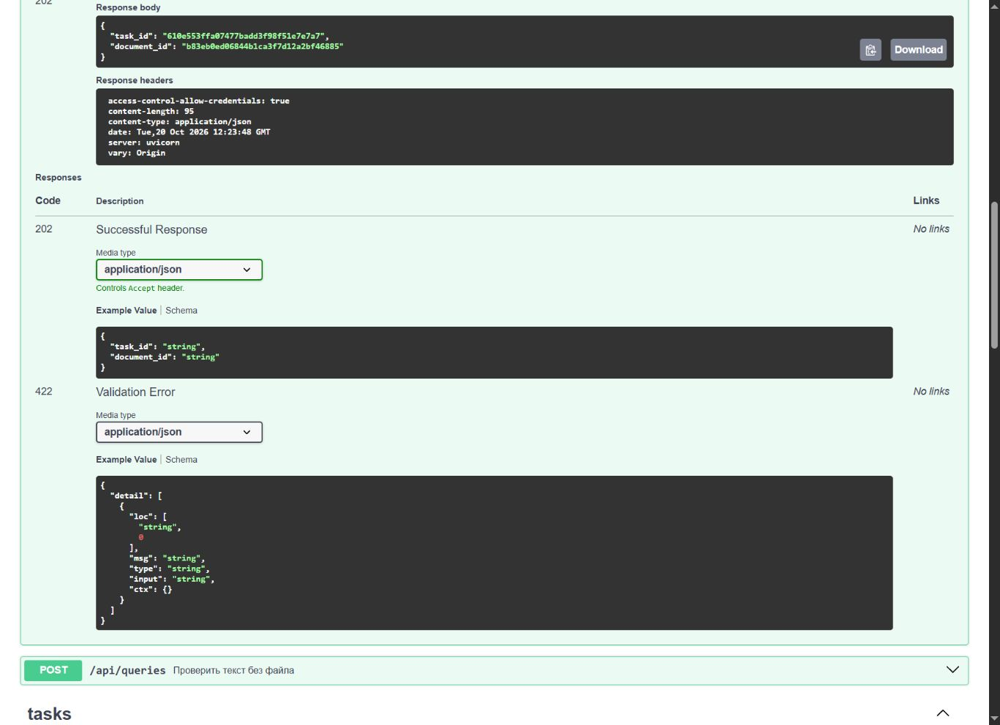
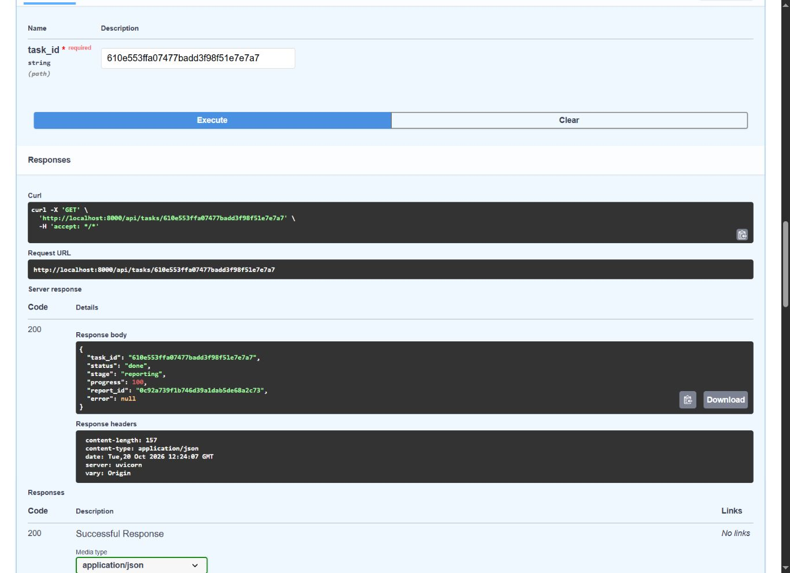
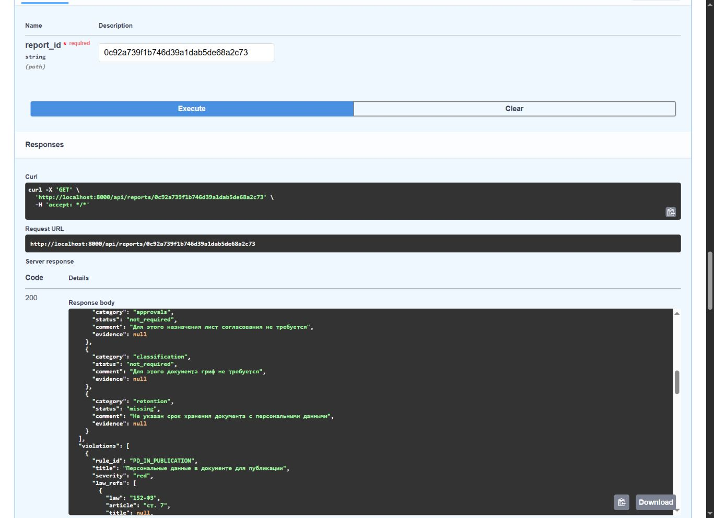

# T-009c — сквозная проверка конвейера

Дата: 20.10.2026. Ветка: `feat/T-009b-pipeline`. PR: [#15](https://github.com/TheWoka/L.A.R.P-B2B/pull/15).

## Что сделано

- Завершено начатое слияние main (`07a4fd9`): `builder.py` взят целиком из входящей версии main, сохранена настоящая реализация T-016. Merge-коммит: `0a57013`.
- После разрешения конфликта выполнен `git pull`: `Already up to date`. Main входит в историю ветки.
- Удалён `test_builder_stub_is_preserved`; остальные тесты с подменой сборщика сохранены.
- В разделе 3 `docs/contracts.md` сигнатура `build_report(..., audit: AuditInfo)` встречается ровно один раз. Контракт и схемы не изменены.
- Добавлены три сквозных теста: текст для публикации, DOCX договора с листом согласования и без грифа, отсутствующий отчёт (404 «Отчёт не найден»).
- SQLite использует StaticPool, API получает сессию через dependency override, uploads изолирован в tmp_path, вызов Celery delay записывает task_id. Режим LLM — mock. Детекция, маркеры, маскирование, правила, сборщик и run_pipeline настоящие.
- Проверяются валидность Report/ReportText, done/100%, правила публикации, три пункта чек-листа, mock/0 вызовов LLM, filename, сохранение длины текста, удаление исходника, отсутствие исходных ПДн в JSON ответа, сегментах текста, сохранённых JSON БД и caplog. Дополнительно проверяются типы найденных сущностей и координаты цитат.

## Файлы

- `backend/app/services/report/builder.py` — разрешение конфликта в merge-коммите, содержимое main целиком.
- `backend/tests/test_pipeline.py` — удалён тест заглушки.
- `backend/tests/test_e2e.py` — три новых сквозных теста.
- `docs/reports/T-009c/report.md` — этот отчёт.
- `docs/reports/T-009c/swagger-upload.jpg`, `swagger-task.jpg`, `swagger-report.jpg` — доказательства ручной проверки.

Остальные файлы merge-коммита пришли из main; вручную в рамках T-009c не редактировались. `docs/planning/` не изменялся. Все входные данные выдуманные, секреты не добавлены.

## Тесты и команды

Число тестов после слияния main до T-009c → после T-009c: **1107 → 1109** (+3 новых, −1 устаревший). Значение «до» рассчитано по разнице тестов; отдельный прогон прежнего состояния не выполнялся. Текущая коллекция подтверждена `pytest --collect-only -q`: 1109.

Итог полного прогона: **1097 passed, 12 skipped, 1 warning**, 16.48 с. Отдельный прогон: **3 passed, 1 warning**, 0.54 с.

Команды выполнены последовательно, build первым. Пустая колонка оставлена для повторной проверки ревьюером.

| Команда PowerShell | Фактический результат | Повторная проверка |
|---|---|---|
| `docker-compose build api` | exit 0, API Built | __________ |
| `docker-compose run --rm --no-deps api ruff check .` | exit 0, All checks passed! | __________ |
| `docker-compose run --rm --no-deps api pytest -q` | exit 0, 1097 passed, 12 skipped | __________ |
| `docker-compose run --rm --no-deps api pytest tests/test_e2e.py -v` | exit 0, 3 passed | __________ |
| `docker-compose down -v` | exit 0, локальные pgdata/uploads пересозданы | __________ |
| `docker-compose up --build -d` | exit 0, все пять сервисов запущены | __________ |

12 пропусков: два теста требуют `/eval`, один — мок отчёта фронтенда, один — `docs/rules.md`, ещё восемь — моки схем фронтенда; этих файлов нет в образе API. Предупреждение pytest — StarletteDeprecationWarning о httpx. Сборка фронтенда успешна с предупреждением Vite о JS-чанке больше 1000 kB.

## Проверка Swagger

Через `http://localhost:8000/docs` загружен выдуманный `T-009c-synthetic.docx` с ФИО, паспортом, телефоном и себестоимостью, назначение `publication`. Использовались настоящие PostgreSQL, Redis и Celery worker; ручного вызова run_pipeline здесь не было.

1. `POST /api/documents`: **202**, task_id `610e553ffa07477badd3f98f51e7e7a7`, document_id `b83eb0ed06844b1ca3f7d12a2bf46885`.
2. `GET /api/tasks/{id}`: **200**, `status=done`, `stage=reporting`, `progress=100`, `error=null`, report_id `0c92a739f1b746d39a1dab5de68a2c73`. Первый запрос уже увидел завершённую задачу.
3. `GET /api/reports/{id}`: **200**, `overall=red`, `processing_ms=573`, filename совпал, найдены PERSON/PASSPORT/PHONE/TRADE_SECRET. Провайдер `mock`, `llm_calls=0`.
4. Полный список rule_id: `PD_IN_PUBLICATION`, `TRADE_SECRET_IN_PUBLICATION`, `TRADE_SECRET_WITHOUT_MARK`, `CHECKLIST_NO_RETENTION`.
5. Дополнительный GET `/text`: длина безопасного текста 156 символов. Проверка БД и тома подтвердила `stored_path is None` и отсутствие исходного DOCX в uploads.

## Как устроен конвейер — для защиты

HTTP-обработчик сохраняет исходник во временный файл, записывает задачу и передаёт Celery только её идентификатор, поэтому анализ не задерживает HTTP-запрос.
Воркер извлекает текст и сегменты, затем run_audit запускает detect для поиска сущностей и find_markers для реквизитов чек-листа.
Далее mask создаёт текст с плейсхолдерами для LLM, а mask_preserving_length — безопасный текст той же длины для отчёта и подсветки; исходный текст и mapping остаются в памяти процесса.
На стадии checking движок проверяет правила, а reporting формирует audit с хэшами и версиями, нарушения, светофор и три пункта чек-листа; в текущем mock-сценарии внешних обращений LLM нет.
В БД сохраняются только Report и ReportText: значения найденных ПДн уже замаскированы детекторами, цитаты правил берутся из value_masked, доказательства чек-листа и тексты сегментов — из безопасного текста, а исходник удаляется в finally.
В штатные логи воркер пишет идентификаторы, стадии, время и количества сущностей, а неожиданные исключения — по имени типа без содержимого; отсутствие исходных ПДн в двух успешных сценариях подтверждено сквозными тестами, но это не универсальная гарантия для пропущенных детектором данных или произвольных имён файлов и ошибок.

## Отклонения и ограничения

- GitHub Desktop недоступен для автоматизации; по последующему прямому разрешению пользователя Git выполнен через консоль.
- Первый pull был заблокирован незавершённым слиянием; сначала разрешён конфликт и завершён merge, затем pull выполнен успешно. Конфликт затрагивал импорты сборщика, а не только комментарий.
- Docker Engine первоначально не был запущен. Docker Desktop запущен, обязательный build повторён и завершился успешно до ruff/pytest.
- Реализация production-конвейера за пределами разрешения конфликта не менялась. Ветка не мерджится в main без ревью тимлида.
- Новые тесты доказывают безопасность проверенных сценариев. `TaskRow.error` получает `str(exc)` для ValueError, а исходное имя файла хранится в DocumentRow/Report; эти пути не дают общей гарантии отсутствия любых ПДн в БД для произвольного ввода. Внешние LLM-условия пока пропускаются движком правил (T-013); сетевой LLM-путь этими mock-тестами не проверяется.

## Описание PR

Что сделано: сохранён сборщик T-016 из main, удалён тест заглушки, добавлены сквозные проверки API → настоящий конвейер → сохранение → чтение отчёта и безопасного текста. Как проверить: четыре команды Docker из таблицы выше. Что не сделано / сомнения: сетевой LLM, экспорт и обезличенная копия остаются в своих задачах; ограничения и пропуски тестов перечислены выше.
