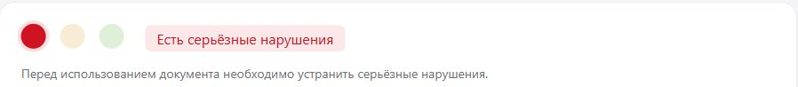
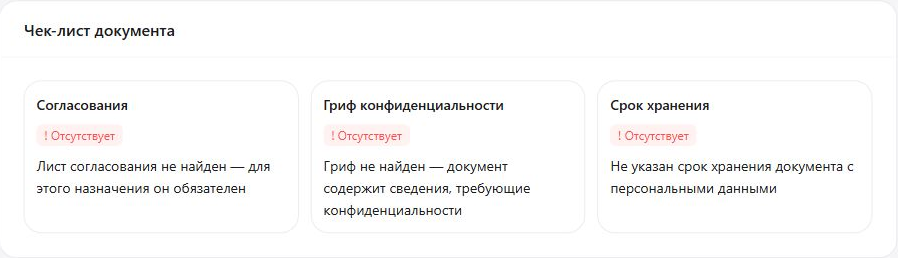
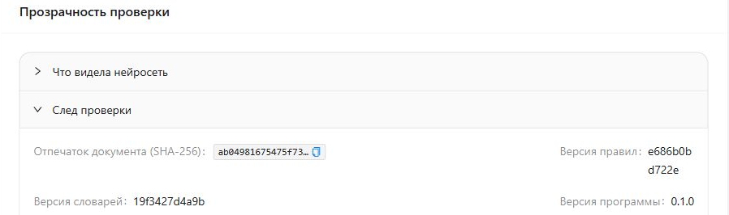

# Как читать отчёт «Гриф»

Памятка для юриста и специалиста по закупкам. Все примеры и снимки — из учебных
документов с выдуманными данными.

## 1. За 30 секунд

**Красный** — есть серьёзные нарушения: документ в таком виде отправлять нельзя.
**Жёлтый** — есть замечания: изучите и исправьте их.
**Зелёный** — нарушений не найдено, но это не юридическое заключение.
Одного серьёзного нарушения достаточно для красного итога. Сначала проверьте
назначение документа, затем прочитайте нарушения и рекомендации.

## 2. Чек-лист

Три пункта: **согласования** — лист согласования, подписи или визы;
**гриф конфиденциальности** — отметка об ограничении доступа;
**срок хранения** — срок либо условие уничтожения данных.
«**Есть**» — нужная запись найдена; «**Отсутствует**» — запись нужна по правилам
проверки, но не найдена; «**Не требуется**» — эти правила её не требуют
для выбранного назначения и найденных данных. Читайте пояснение под статусом.

Для публикации гриф не требуется: коммерческую тайну нужно исключить.
Для договора проверяется согласование, а при наличии паспортных данных — срок
хранения. «Есть» подтверждает наличие записи, а не правильность её содержания.

## 3. Нарушения: что делать

У каждого нарушения есть **уровень**, **статья закона или пункт регламента**
и **рекомендация**. Нажмите на статью — откроется её текст; если текст внутреннего
регламента не включён в каталог, запросите его в своей организации.
Раскройте строку нарушения и нажмите на **цитату** — нужное место подсветится
в тексте документа. При отсутствии обязательного раздела цитаты может не быть.

Сначала устраните серьёзные нарушения, затем замечания: сверьте находку с исходником,
внесите правку по рекомендации, при сомнении обсудите её с юристом. Загрузите
исправленный документ повторно с тем же назначением.

## 4. Найденные данные

Здесь показаны ФИО, паспорт, СНИЛС, ИНН физлица, телефон, электронная почта,
адрес, дата рождения, номера карт и счетов; отдельно — финансовые сведения,
коммерческая тайна и особые категории данных, например сведения о здоровье
или убеждениях человека. Находка сама по себе ещё не означает нарушение.

Персональные данные скрыты: выдуманное «Иванов Иван» видно как «И█████ И███».
Первые буквы и разделители помогают найти место в исходнике. Коммерческая тайна
и финансовые сведения показаны открыто, чтобы вы могли оценить, что именно найдено.
Поэтому сам отчёт тоже не следует публиковать без просмотра.

## 5. Обезличенная копия

Нажмите «**Скачать обезличенную копию**», если кнопка доступна. В копии найденные
персональные данные, включая особые категории, удалены или заменены; в PDF они
удалены из содержимого, а не просто закрашены сверху. Скопировать удалённые
значения из неё нельзя. Формат файла сохраняется.

**Коммерческая тайна и финансы остаются.** Перед публикацией откройте копию:
проверьте пропущенные личные сведения, картинки и оставшуюся конфиденциальную
информацию. Публиковать её можно после этой проверки и необходимых исправлений.
Недоступная кнопка означает, что копия не создана; это не подтверждение безопасности.

## 6. «Прозрачность проверки»

В «**Что видела нейросеть**» показан отправленный ей текст: найденные персональные
данные заменены метками вроде `[PERSON_1]` **до отправки**. Коммерческая тайна
и финансы в этом тексте остаются. Без нейросети отправки нет.

«**След проверки**» хранит отпечаток документа и версии правил, словарей и программы.
Они помогают установить, какой файл и какими средствами проверяли, и сопоставить
результаты повторной проверки. Отпечаток не раскрывает содержимое файла.

## 7. «Не удалось проверить»

Нейросеть может быть выключена, не ответить вовремя или не дать подтверждённого
ответа. Тогда проверка смысла соответствующего условия не завершена; это **не значит
«нарушений нет»**. Продолжают работать шаблоны номеров, проверка контрольных цифр,
распознавание имён, словари, обычные правила и чек-лист. Дополнительный поиск
нейросетью и зависимые от её ответа условия остаются непроверенными.
Проверьте их вручную или повторите проверку, когда нейросеть станет доступна.

## 8. Чего «Гриф» не делает

Не заменяет юриста, не читает сканы без текстового слоя и не проверяет картинки.
Может пропустить данные или ошибиться в находке. Решение об отправке документа
принимает человек после просмотра исходника, отчёта и подготовленной копии.
